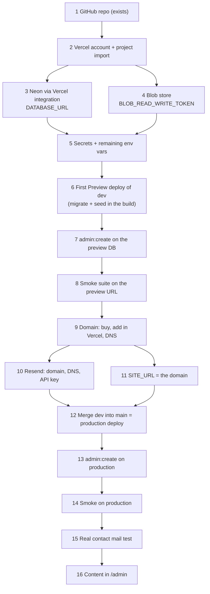

# Deploy runbook and account setup

How to take this repo from GitHub to a live site on Vercel: every account, every
value, in order, with where each value comes from and where it goes.

- **Written:** 2026-10-14, for an attended session (the owner logged in, Claude
  driving the dashboards in Chrome).
- **Docs read on 2026-10-14:** Neon "Vercel-managed integration", Vercel Blob
  (overview and pricing), Vercel "Adding & Configuring a Custom Domain",
  Vercel "System environment variables", Vercel "Configuring regions for
  Vercel Functions", Vercel "Hobby plan", Vercel "Protection Bypass for
  Automation", and Resend's domain docs and DNS provider guides. Dashboards
  change, so anything those pages describe is marked **(check in the
  dashboard)**. Everything else was checked in this repo's code.
- **No secrets in this file.** `<like-this>` is a placeholder. Real values live
  only in Vercel, in a password manager, and (when needed) in the git-ignored
  `.env.production.local`. `.gitignore` ignores `.env*` except `.env.example`.

The owner's laptop runs Windows with Git Bash. pnpm is only available as
`corepack pnpm`, so every command below is written that way.

---

## 1. Overview and order



| # | Step | Time | Why it comes before the next one |
| --- | --- | --- | --- |
| 1 | GitHub repo | 0 min (exists: `DorobatMihaiGit/presentation`) | Vercel imports from it. Vercel Hobby cannot import repos owned by a GitHub organization; this one is under a personal account. |
| 2 | Vercel account and project import | 10 min | The Neon integration and the Blob store attach to a Vercel project, so the project must exist first. |
| 3 | Neon through the Vercel integration | 10 min | The app refuses to build without `DATABASE_URL` (`src/env.ts` is imported by `next.config.ts`, and the schema requires it). |
| 4 | Blob store | 5 min | Creates `BLOB_READ_WRITE_TOKEN`. Without it, uploads throw on Vercel (`src/server/media/index.ts`), and the image host for `/_next/image` and the CSP comes from it. |
| 5 | Secrets and remaining env vars | 15 min | `BETTER_AUTH_SECRET` and `ADMIN_EMAIL` are required by the schema; the build fails without them. |
| 6 | First deploy of `dev` as a Preview | 10 min (build ~3 to 5 min) | Proves the build, migrations and env work before anything is public. |
| 7 | `admin:create` against the preview database | 5 min | Public sign-up is disabled; the script is the only way to create the account. |
| 8 | Smoke suite on the preview URL | 5 min | A read-only check that headers, pages, SEO files and the admin gate work on Vercel. |
| 9 | Domain | 20 min + DNS wait (minutes to hours) | Resend can only verify a domain you own, and `SITE_URL` should point at it. |
| 10 | Resend | 20 min + DNS wait (up to 72 h, usually much faster) | Mail only leaves from a verified domain. |
| 11 | `SITE_URL` set to the domain | 5 min | Canonical URLs, sitemap, the Better Auth base URL and the passkey rpID all come from it, and they are fixed at build time. |
| 12 | Merge `dev` into `main` | 10 min (build ~3 to 5 min) | `main` is the production branch. |
| 13 | `admin:create` against production | 5 min | Production has its own database branch. |
| 14 | Smoke on production | 5 min | Same checks on the real origin, including HSTS. |
| 15 | Real contact mail test | 10 min | Proves Resend, SPF, DKIM and DMARC end to end. |
| 16 | Content in `/admin` | open-ended | The first build seeds the placeholder CV; the owner replaces it. |

**Total:** about 3 hours of hands-on time, plus DNS waiting.

**What can wait.** The domain (9), Resend (10) and `SITE_URL` (11) can come
after a working `.vercel.app` production. The short path is
1 → 8, then 12 → 14 with `SITE_URL=https://<project>.vercel.app`, then 9, 10,
11, a redeploy, 14 again and 15. Until Resend works, every contact message is
still stored, with `email_status = failed` (`src/server/email/mailer.ts`,
`src/server/contact/submit.ts`). **Do not register passkeys before the final
`SITE_URL` is live** (see §6).

---

## 2. Decisions to make first

| Decision | Recommendation | Why |
| --- | --- | --- |
| Regions | Vercel Functions in `fra1` (Frankfurt) and Neon on AWS `eu-central-1` (Frankfurt). Blob store in `fra1` too. | Every public page is prerendered and served from the CDN, so the region only matters for server work: admin, the contact form, `/_next/image`. Putting the functions next to the database keeps each query short; Frankfurt is close to Romania. New Vercel projects default to `iad1` (Washington), so this must be changed. Check that Neon's integration offers `eu-central-1` **(check in the dashboard)**. Hobby allows one function region. A Blob store's region cannot be changed later. |
| Project name | `cv` or `<firstname>-<lastname>` | It becomes `<project>.vercel.app` and is part of every preview URL (`<project>-git-dev-<scope>.vercel.app`). Short and personal reads better if the vercel.app URL is ever shared. |
| Domain | A `.com` with your name if available; `.ro` if you want a local signal. | `.com` is cheaper to buy and renew at mainstream registrars (Porkbun, Namecheap, or Vercel itself); `.ro` is sold by ROTLD-accredited registrars and suits a Romanian audience. Either works with Vercel and Resend. Compare first-year and renewal prices **(check at the registrar; the owner pays)**. |
| Primary host | The apex (`https://<domain>`) as `SITE_URL`, with `www` redirecting to it. | Vercel recommends `www` as primary, but this site sends `Strict-Transport-Security: max-age=63072000; includeSubDomains; preload` from Next (`src/lib/security-headers.ts`). HSTS preload checks the apex's own HTTPS response. If Vercel's domain-level redirect answers for the apex, our headers may not be on it. With the apex as primary, Next answers the apex. |
| Hobby or Pro | Hobby to start. | Hobby is free and covers this site's traffic. Hobby is **non-commercial only** (spec §8 and Vercel's fair-use guidelines). A personal CV for job hunting is personal use; if the site starts advertising paid services or freelance work, move to Pro ($20/month). |
| Contact inbox (`CONTACT_TO_EMAIL`) | The mailbox you read daily, for example your Gmail. Leave empty to use `ADMIN_EMAIL`. | The owner notification goes here, with reply-to set to the visitor (`src/server/email/index.ts`). |
| Sender (`CONTACT_FROM_EMAIL`) | `contact@<domain>` | Resend sends only from a verified domain. `pnpm deploy:check` requires the sender's domain to match `SITE_URL`'s when `RESEND_API_KEY` is set. Resend suggests sending from a subdomain to keep reputation separate; this setup verifies the domain itself and Resend's return path still lives on `send.<domain>`. If you prefer a subdomain sender, first check how `scripts/deploy-check.ts` compares the two domains. |
| Branches | Production branch `main`; previews from `dev`. | `main` is Vercel's default production branch. Work already merges into `dev`; previews from `dev` are the staging site. |
| Neon preview branching | On. | Each Preview deployment gets its own copy-on-write database branch (`preview/<git-branch>`), so a migration in a preview build never touches production data. With it off, Preview and Production share one database and a preview build migrates production. |
| Blob store per environment | One public store for Production and Preview. | Preview database branches are copies of production, so their media rows point at the production store's URLs; one store keeps those images working on previews. Caveat: **deleting a media item in a preview's admin deletes the real file** (`src/server/actions/media.ts` calls `store.delete`). Only delete media in production. |

---

## 3. Accounts to have

| Account | What it is for | Free tier (as read 2026-10-14) |
| --- | --- | --- |
| GitHub (exists, `DorobatMihaiGit`) | Source, CI (`.github/workflows/ci.yml`), the manual smoke workflow (`.github/workflows/smoke.yml`). | Public repos: unlimited Actions minutes. Private repos: a monthly minute quota **(check in GitHub billing)**. |
| Vercel (sign up with GitHub) | Hosting, builds, previews, env vars, domains, Blob, Web Analytics, Speed Insights. | Hobby: 100 GB Fast Data Transfer, 1M function invocations, 4 active CPU-hours, 5,000 image transformations, 100 deployments a day, 1 function region, 1 hour of runtime logs, 50,000 Web Analytics events a month, 10,000 Speed Insights events over 30 days. Blob on Hobby: 1 GB storage, 10,000 simple and 2,000 advanced operations, 10 GB Blob data transfer. Going over pauses the feature for 30 days; nothing is billed. |
| Neon (created through the Vercel integration) | Postgres. | Free: 0.5 GB storage per project, 100 CU-hours of compute per project a month, 10 branches per project, scale to zero after 5 minutes idle (Neon's FAQ). Preview branches count towards the 10; delete old `preview/*` branches. |
| Resend | Sends the owner notification and the visitor auto-reply. | About 3,000 mails a month and 100 a day, with at least one verified domain (third-party summaries disagree on the domain count; **check on resend.com/pricing**). On the free plan sending pauses at the cap. |
| Domain registrar | Owns the domain and hosts its DNS. | Paid (owner). |
| Renovate (optional, GitHub app) | Weekly dependency PRs into `dev`, per `renovate.json` (Monday before 6 am, Europe/Bucharest). | Free. Install from github.com/apps/renovate on this repo only. |

---

## 4. The env var matrix

The app schema is `src/lib/create-app-env.ts` (wired in `src/env.ts`). It runs
at build time (`next.config.ts` imports `./src/env`) and at runtime, so a
missing or invalid required variable fails the build with `Invalid environment
variables`. Empty strings count as unset (`emptyStringAsUndefined: true`).

**Scripts do not read `.env.production.local`.** `db:migrate`, `db:seed` and
`admin:create` load only `.env.local` (`node --env-file-if-exists=.env.local`).
Node gives variables already set in the shell priority over the file, so
export the production values in the shell first (see step 7).

| Variable | Required? | Production | Preview | Development (local) | Who creates it | How to generate | How to verify |
| --- | --- | --- | --- | --- | --- | --- | --- |
| `DATABASE_URL` | Yes (`postgres://` or `postgresql://` URL) | Neon main branch, **pooled** | Neon `preview/<git-branch>` branch, pooled, injected per deployment (not visible in Vercel's env var list) | `postgres://cv:cv@localhost:5432/cv` (docker compose) | Neon integration | Nothing to generate | `pnpm deploy:check --online` reports the applied migrations; the build log shows `migrations applied` |
| `DATABASE_URL_UNPOOLED` | Not read by the app | Neon direct URL | Neon direct URL | not set | Neon integration | — | Present in Vercel env vars **(check in the dashboard)**. Use it only for one-off laptop commands if the pooler gives trouble. |
| `SITE_URL` | Optional in the schema; set it explicitly in Production | `https://<project>.vercel.app` until step 11, then `https://<domain>` | `https://<project>-git-dev-<scope>.vercel.app`, scoped to the `dev` branch if the dashboard allows **(check in the dashboard)** | empty (= `http://localhost:3000`) | Owner | Copy the URL from the Vercel dashboard; origin only, no trailing path | `view-source:` on `/en`: `<link rel="canonical">` starts with it; `/robots.txt` and `/sitemap.xml` use it; `deploy:check` requires https |
| `BETTER_AUTH_SECRET` | Yes (at least 32 characters) | A new random value | A **different** random value | the `.env.example` dev value | Owner | `openssl rand -base64 32` in Git Bash (Git for Windows ships OpenSSL), once per environment | `deploy:check` (length and not the `.env.example` value). Sign-in works after deploy. |
| `ADMIN_EMAIL` | Yes (an email, lowercased) | Owner's email | Same | `admin@example.com` or your own | Owner | — | `admin:create` prints `created admin <email>` |
| `BLOB_READ_WRITE_TOKEN` | Optional in the schema; **needed on Vercel** (uploads throw without it) | The store's read-write token | Same store | empty (uploads go to `.data/media`) | Blob store (step 4) | Created with the store | `deploy:check`; an upload in `/admin` returns a `*.public.blob.vercel-storage.com` URL |
| `BLOB_PUBLIC_HOST` | Optional | empty if the token is in the standard format, else `<storeId>.public.blob.vercel-storage.com` | Same | empty | Owner | Copy the host from any blob URL in the store's file browser | `deploy:check` (an image host for Blob); a cover renders through `/_next/image` with 200 |
| `RESEND_API_KEY` | Optional (must start with `re_`) | Resend key, "Sending access", limited to the domain | Same key, or empty (preview mails then fail and are stored as failed) | empty (mails written to `.data/mail/`) | Resend (step 10) | Resend → API Keys → Create | `deploy:check`; step 15 mail arrives |
| `CONTACT_FROM_EMAIL` | Required when `RESEND_API_KEY` is set | `contact@<domain>` | Same | `contact@example.com` | Owner | — | `deploy:check` (domain matches `SITE_URL`); Gmail "Show original" (step 15) |
| `CONTACT_TO_EMAIL` | Optional (defaults to `ADMIN_EMAIL`) | Owner's inbox | Same or empty | empty | Owner | — | Step 15 notification arrives there |
| `NEXT_PUBLIC_ASSET_BASE` | Optional (absolute URL) | empty (same origin) | empty | empty | Owner (only if `/public` media ever moves to a CDN) | — | Leave empty. It is inlined into client code at build time. |
| `ENABLE_EXPERIMENTAL_COREPACK` | Build setting, not in the schema | `1` | `1` | not needed | Owner | — | Build log shows pnpm 11.27.1 (from `package.json#packageManager`) |
| `VERCEL` | Set by Vercel (`1`, build and runtime) | auto | auto | unset | Vercel | — | Analytics and Speed Insights render only when `VERCEL=1` at build time (`src/components/site/VercelInsights.tsx`). With `VERCEL` set, missing Blob token or Resend key fail loudly instead of writing to disk. |
| `VERCEL_PROJECT_PRODUCTION_URL` | Set by Vercel (build and runtime) | auto: shortest production custom domain, else `<project>.vercel.app` | auto: the **production** host, even on previews | unset | Vercel | — | Used only when `SITE_URL` is empty (`src/site.ts`, `resolveSiteUrl`). That is why Preview needs its own `SITE_URL`. |
| `VERCEL_ENV` | Set by Vercel | `production` | `preview` | unset | Vercel | — | Not read by this code. |
| `ADMIN_PASSWORD` | Script only, never in Vercel | — | — | — | Owner, typed into the shell for one command | Password manager; 12 to 128 characters (`MIN_PASSWORD_LENGTH = 12`) | `admin:create` output |
| `SMOKE_URL` | Smoke suite only, never in Vercel | — | — | — | Owner, per run | The URL under test | `pnpm smoke` runs |

**Pooled or unpooled for migrations?** `scripts/db-migrate.ts` and the app
both use `DATABASE_URL` through node-postgres (`src/server/db/create-db.ts`);
`drizzle.config.ts` has no database URL at all (it only generates SQL). The
Drizzle migrator uses plain statements and transactions, nothing that needs a
session, so the pooled URL works for migrations. Keep the build on
`DATABASE_URL`: with preview branching, the per-branch pooled URL is what Neon
injects for that deployment. Whether it also replaces `DATABASE_URL_UNPOOLED`
per branch is not documented, so a build that migrates through
`DATABASE_URL_UNPOOLED` might hit the main branch from a preview. The runtime
pool calls `attachDatabasePool` from `@vercel/functions` (`src/server/db/index.ts`),
which closes idle clients before a Fluid compute instance suspends.

---

## 5. Step by step

### Step 1: GitHub repo (exists)

- **Check:** `git remote -v` shows `https://github.com/DorobatMihaiGit/presentation.git`;
  `dev` and `main` exist on GitHub; CI on `dev` is green (`gh run list --branch dev --limit 3`).
- **If it goes wrong:** if `main` is far behind `dev`, that is expected; step 12 merges it.

### Step 2: Vercel account and project import

**Where to click**

1. vercel.com/signup → **Continue with GitHub** → Hobby.
2. **Add New → Project** → import `DorobatMihaiGit/presentation`. Grant the
   Vercel GitHub app access to this repo only.
3. On the configure screen **(check in the dashboard)**:
   - Project name: from §2.
   - Framework preset: Next.js (auto-detected).
   - Root directory: `./` (the repo root).
   - Expand **Build and Output Settings** and override:
     - Install command: `pnpm install --frozen-lockfile`
     - Build command: `pnpm db:migrate && pnpm db:seed && pnpm build`
     - Output directory: leave default.
   - Expand **Environment Variables** and add `ENABLE_EXPERIMENTAL_COREPACK` = `1`
     for all environments. Without it Vercel picks pnpm 9/10 from the
     lockfile instead of 11.27.1.
4. Click **Deploy** anyway, or cancel it. This first build **fails** with
   `Invalid environment variables` because there is no database yet. That
   is the env gate working.
5. Project → **Settings → Functions → Function Regions**: choose `fra1`
   (Frankfurt). There is no `vercel.json` in this repo, so the dashboard
   setting is the only one.
6. Project → **Settings → Git**: production branch `main` **(check in the dashboard)**.
   Git LFS: leave off; `.gitattributes` tracks nothing in LFS.
7. Node version: `package.json` has `"engines": { "node": "24.x" }`, which
   Vercel follows. Confirm **Settings → Build and Deployment → Node.js
   Version** shows 24.x **(check in the dashboard)**.

**Why `db:seed` is in the build command.** The plan's command was
`pnpm db:migrate && pnpm build`. That fails on a new database: `next build`
prerenders `/en` and `/ro` from Postgres, and `loadCvRecords` throws
`CV profile row is missing` when there is no profile row
(`src/server/queries/cv.ts`). `pnpm db:seed` loads the placeholder CV only
when the `profile` table is empty and prints `skipped: CV content already
exists` otherwise (`src/server/db/seed.ts`), so it never overwrites real
content. Never put `--reset` in the build command.

**CLI alternative** (optional; run in Git Bash in the repo):

```bash
corepack pnpm dlx vercel login
corepack pnpm dlx vercel link          # creates .vercel/ (git-ignored)
corepack pnpm dlx vercel env add ENABLE_EXPERIMENTAL_COREPACK production
corepack pnpm dlx vercel env add ENABLE_EXPERIMENTAL_COREPACK preview
```

- **Check:** the project exists; Settings shows the overridden install and
  build commands, `fra1` and `ENABLE_EXPERIMENTAL_COREPACK`.
- **If it goes wrong:**
  - The repo is not listed: the Vercel GitHub app does not have access to it
    (GitHub → Settings → Applications → Vercel → Configure).
  - The build log shows pnpm 9 or 10: `ENABLE_EXPERIMENTAL_COREPACK` is missing
    for that environment.

### Step 3: Neon through the Vercel integration

**Where to click** **(check in the dashboard; read 2026-10-14)**

1. Project → **Storage** → **Create Database** (or Marketplace → Neon →
   Install) → choose a new Neon account managed by Vercel.
2. Region: AWS `eu-central-1` (Frankfurt). Plan: Free.
3. Connect it to this project for **Production, Preview and Development**.
4. Under **Advanced Options → Deployments Configuration**, turn on
   **Required → Preview** (a branch per preview deployment, named
   `preview/<git-branch>`). Keep **Resource must be active before deployment** on.

**Values:** the integration injects `DATABASE_URL` (pooled),
`DATABASE_URL_UNPOOLED`, `PGHOST`, `PGHOST_UNPOOLED`, `PGUSER`, `PGDATABASE`,
`PGPASSWORD` and legacy `POSTGRES_*` names. Nothing to copy by hand. Preview
branch URLs are injected at deploy time and are not shown in Vercel's
env var list.

- **Check:** Settings → Environment Variables lists `DATABASE_URL` for
  Production and Preview. Storage → the database → **Open in Neon** shows
  the project in `eu-central-1` with a `main` (or `production`) branch.
- **If it goes wrong:**
  - The region list has no Frankfurt: pick the nearest EU region and set the
    Vercel function region to match (for example `dub1` with `eu-west-1`).
  - `DATABASE_URL` only exists for some environments: edit the connection
    under Storage and tick the missing ones.

### Step 4: Blob store

**Where to click** **(check in the dashboard)**

1. Project → **Storage** → **Create** → **Blob**.
2. Name: `cv-media`. Region: `fra1`. Access: **Public**. The code uploads
   with `access: "public"` (`src/server/media/store.ts`), and access mode
   cannot be changed after the store is created.
3. Connect it to the project for **Production and Preview**. Development
   is not needed (local dev uses `.data/media`).

**Values:** Vercel's current docs say a connected project now authenticates
with OIDC by default (`BLOB_STORE_ID`, `VERCEL_OIDC_TOKEN`) and that
`BLOB_READ_WRITE_TOKEN` is "added to your project when you create a store".
This code passes `BLOB_READ_WRITE_TOKEN` explicitly and throws on Vercel
without it, so:

- Open Settings → Environment Variables and confirm `BLOB_READ_WRITE_TOKEN`
  exists for Production and Preview.
- If it does not, copy the read-write token from the store's page
  (`.env.local` snippet or token section) **(check in the dashboard)** and add
  it by hand as a Sensitive variable for Production and Preview.
- The token looks like `vercel_blob_rw_<storeId>_<secret>`. In that format the
  app derives the image host `<storeId>.public.blob.vercel-storage.com` by
  itself. If the token has another shape, set `BLOB_PUBLIC_HOST` to the host
  part of any blob URL in the store's browser.

- **Check:** after step 6, upload a cover in `/admin` → Media. The stored URL
  starts with `https://<storeId>.public.blob.vercel-storage.com/media/`, and
  the cover renders on the project page.
- **If it goes wrong:** see "Images return 400" in §6.

### Step 5: Secrets and the remaining env vars

**Where to click:** Project → **Settings → Environment Variables**. Add each
row of the matrix (§4) with the right environments ticked. Mark secrets
(`BETTER_AUTH_SECRET`, `BLOB_READ_WRITE_TOKEN`, `RESEND_API_KEY`) as
**Sensitive** **(check in the dashboard)**; their values cannot be read back
afterwards, so keep a copy in the password manager.

For now add:

| Variable | Production | Preview |
| --- | --- | --- |
| `BETTER_AUTH_SECRET` | `openssl rand -base64 32` (value A) | `openssl rand -base64 32` (value B, different) |
| `ADMIN_EMAIL` | `<owner email>` | `<owner email>` |
| `SITE_URL` | `https://<project>.vercel.app` | `https://<project>-git-dev-<scope>.vercel.app` (branch `dev`) |
| `CONTACT_TO_EMAIL` | `<inbox>` (or leave empty) | same |

Leave `RESEND_API_KEY` and `CONTACT_FROM_EMAIL` unset until step 10.

Generate a secret in Git Bash (do not paste it into chat; copy it straight
into Vercel and the password manager):

```bash
openssl rand -base64 32
```

**Rotating `BETTER_AUTH_SECRET` later signs everyone out, makes stored TOTP
secrets unreadable (the owner must run `admin:create --reset-2fa`) and
changes the IP hashes used by the contact rate limit.** Treat the production
value as permanent.

**Preflight from the laptop (optional but recommended).** Put the
production values in `.env.production.local` (git-ignored), single-quoted
because Neon URLs contain `&`:

```bash
# .env.production.local (never commit; delete after the session if you like)
DATABASE_URL='<neon pooled url, main branch>'
SITE_URL='https://<project>.vercel.app'
BETTER_AUTH_SECRET='<value A>'
ADMIN_EMAIL='<owner email>'
BLOB_READ_WRITE_TOKEN='<token>'
```

Then:

```bash
corepack pnpm deploy:check                 # names and pass/fail only
corepack pnpm deploy:check --online        # also connects and counts migrations
```

The Neon URL is in Neon Console → project → **Connect** (pooled toggle on)
**(check in the dashboard)**. `vercel env pull .env.production.local
--environment=production` also writes it, but Sensitive values come back empty.

- **Check:** `deploy:check` passes every line; the Vercel list shows each
  variable with the right environments.
- **If it goes wrong:** `deploy:check` names the failing variable. Typical:
  a secret shorter than 32 characters, `SITE_URL` with `http://`, an email with
  a trailing space.

### Step 6: First deploy of `dev` as a Preview

**Where to click:** the import in step 2 builds the production branch (`main`),
not `dev`. To get a `dev` preview, push any commit to `dev` (for example the
merge of this M8 branch), or, if a failed `dev` deployment already exists,
Deployments → that deployment → **Redeploy**. CLI:
`corepack pnpm dlx vercel redeploy <deployment-url>`. Ignore the failed
production build from step 2; step 12 replaces it.

- **Check (build log):** pnpm 11.27.1 via Corepack; `migrations applied`;
  `seeded CV content` (first time) or `skipped: CV content already exists`;
  `✓ Compiled successfully`; the prerender of `/en` and `/ro` succeeds.
- **Check (site):** open `https://<project>-git-dev-<scope>.vercel.app`.
  Previews are behind Vercel Authentication by default, so be logged in.
  `/` redirects to `/en`, `/ro` is Romanian, `/admin` redirects to
  `/admin/login`. Response headers on `/en` include
  `Content-Security-Policy`, `Strict-Transport-Security`, `X-Frame-Options: DENY`.
- **If it goes wrong:**
  - `Invalid environment variables`: the log names the variable. Usually one
    not ticked for Preview.
  - A migration error: see §6.
  - `CV profile row is missing`: `db:seed` is not in the build command.
  - `ERR_PNPM_OUTDATED_LOCKFILE`: the lockfile on `dev` does not match
    `package.json`; fix on a branch, never by dropping `--frozen-lockfile`.

### Step 7: `admin:create` against the preview database

The password prompt uses raw terminal mode, which Git Bash's default
mintty window does not provide to Node (`stdin.isTTY` is false and the script
says `Set ADMIN_PASSWORD or run this in a terminal.`). Read the password into
a variable with `read -s` instead; it is not echoed and not saved in history.

1. Get the preview branch's connection string: Neon Console → project →
   **Branches** → `preview/dev` → **Connect** (pooled) **(check in the dashboard)**.
   Or with `neonctl`: `corepack pnpm dlx neonctl connection-string preview/dev --project-id <neon project id> --pooled`
   (flags as documented by `neonctl connection-string --help`; check before use).
2. In Git Bash, in the repo:

```bash
export DATABASE_URL='<preview/dev pooled url>'
export ADMIN_EMAIL='<owner email>'
export BETTER_AUTH_SECRET='<value B, the Preview secret>'
read -rsp "Admin password: " ADMIN_PASSWORD; echo; export ADMIN_PASSWORD
corepack pnpm admin:create
unset DATABASE_URL ADMIN_EMAIL BETTER_AUTH_SECRET ADMIN_PASSWORD
```

Exporting all three matters: anything not set in the shell is taken from
`.env.local` (the local dev values). Variables set in the shell win over the
file.

Alternative: put the values in `.env.production.local` and load it for one
shell with `set -a; source .env.production.local; set +a` (values must be
single-quoted), then `read -s` the password and run the command.

- **Check:** the script prints `created admin <email>`. Sign in at
  `<preview url>/admin/login`.
- **If it goes wrong:**
  - `Refusing to create ...: it is not ADMIN_EMAIL`: typo or case mismatch.
  - `The password must be 12 to 128 characters long.`
  - A connection timeout: wrong branch URL, or the Neon compute was
    suspended and is waking (retry once).
  - `reset the password of ...` means the account already existed; that is fine.
  - With preview branching, a preview branch copied from production after
    step 13 already has the admin. Its TOTP will not work on the preview,
    because the Preview secret differs; use `admin:create --reset-2fa` on the
    preview branch if you need to sign in there.

### Step 8: Smoke suite on the preview URL

`pnpm smoke` (`playwright.smoke.config.ts`, `tests/smoke/`) is read-only: it
never signs in and never submits the contact form. It needs `SMOKE_URL`.

```bash
SMOKE_URL='https://<project>-git-dev-<scope>.vercel.app' corepack pnpm smoke
```

- Run it against the **dev branch URL**, the same one as Preview's `SITE_URL`.
  The suite checks that `robots.txt` and `sitemap.xml` point at `SMOKE_URL`'s
  origin; any other preview URL fails that check.
- Previews are protected by Vercel Authentication. Either create a
  **Protection Bypass for Automation** secret (Settings → Deployment
  Protection) and send it as the `x-vercel-protection-bypass` header, or turn
  preview protection off for the duration of the run. Whether the smoke config
  forwards a bypass header is **not verified**; read
  `playwright.smoke.config.ts` first.
- Manual workflow, once `smoke.yml` is on the default branch (GitHub only
  lists `workflow_dispatch` workflows from the default branch):
  `gh workflow run smoke.yml -f url=<url>`, then `gh run watch`.

- **Check:** all tests pass. HSTS and `upgrade-insecure-requests` checks only
  run on `https://` origins.
- **If it goes wrong:** a 401 or a Vercel login page means deployment
  protection; a canonical or sitemap mismatch means `SITE_URL` for Preview
  is not the URL you tested; a CSP violation names the blocked host.

### Step 9: Domain (buy, add in Vercel, DNS at the registrar)

1. Buy `<domain>` at the chosen registrar. Turn on WHOIS privacy and
   auto-renew.
2. Vercel → Project → **Settings → Domains** → **Add** `<domain>`. Vercel
   offers to add `www.<domain>` too: accept, and set `www.<domain>` to
   **redirect** to `<domain>` (308) **(check in the dashboard)**.
3. At the registrar's DNS panel, add what Vercel's domain card shows. Use
   the card's values, not the examples:

| Type | Name | Value | Notes |
| --- | --- | --- | --- |
| `A` | `@` | `76.76.21.21`, or the value on Vercel's domain card | Apex. Remove any other `A`/`AAAA`/`CNAME` on `@` (registrar parking). |
| `CNAME` | `www` | the project-specific target on the card (like `<hash>.vercel-dns-0xx.com`) | Remove any existing `www` record. |

Keep the registrar's nameservers (do not move DNS to Vercel); Resend's
records go in the same panel.

- **Check:** the domain card turns green ("Valid Configuration") and the
  certificate is issued. `https://<domain>` serves the production deployment
  (the old `.vercel.app` one until step 12). `https://www.<domain>` redirects
  to the apex. `nslookup <domain>` returns the A value.
- **If it goes wrong:** "Invalid Configuration" usually means a leftover
  parking record or a `www` record with the domain appended twice
  (`www.<domain>.<domain>`). Propagation can take hours; the card re-checks
  by itself.

### Step 10: Resend (account, domain, DNS records, API key)

1. resend.com → sign up (use the owner's email).
2. **Domains → Add Domain** → `<domain>`. Region: the EU one
   (`eu-west-1`, Ireland) if offered **(check in the dashboard)**; the MX value
   depends on the region.
3. Add the records Resend shows at the registrar. Typical shape:

| Purpose | Type | Name | Value | Priority |
| --- | --- | --- | --- | --- |
| Return path (bounces) | `MX` | `send` | `feedback-smtp.<region>.amazonses.com` (copy from Resend) | `10` |
| SPF for the return path | `TXT` | `send` | `v=spf1 include:amazonses.com ~all` (copy from Resend) | — |
| DKIM | `TXT` | `resend._domainkey` | `p=<public key from Resend>` | — |
| DMARC | `TXT` | `_dmarc` | `v=DMARC1; p=none; rua=mailto:<owner mailbox>` | — |

   - Most registrars append the domain: enter `send`, not `send.<domain>`.
   - Some registrars need a trailing dot on the MX value; Resend's copy button includes it.
   - DMARC is not created by Resend; add it yourself. Start at `p=none`
     (report only). After two to four weeks of reports showing SPF/DKIM
     alignment and no unknown senders, tighten to `p=quarantine`.
   - If the domain already has an SPF record on `@` (for example from a
     mailbox provider), leave it; Resend's SPF lives on `send`.
4. Click **Verify DNS Records**. Verification can take up to 72 hours, usually minutes.
5. **API Keys → Create API Key**: name `cv-production`, permission
   **Sending access**, domain `<domain>`. Copy it once (`re_...`).
6. Vercel env vars, Production (and Preview, if you want preview mail):
   `RESEND_API_KEY=<re_...>`, `CONTACT_FROM_EMAIL=contact@<domain>`.
   Setting the key without the sender fails at boot (`createFinalSchema` in
   `src/lib/create-app-env.ts`).

- **Check:** the domain shows **Verified** in Resend; `deploy:check` passes
  the sender-domain rule.
- **If it goes wrong:** a record stays "Pending": compare the published value
  with `nslookup -type=TXT resend._domainkey.<domain>`; look for the doubled
  domain name or a split/quoted DKIM value.

### Step 11: `SITE_URL` set to the domain

1. Vercel env vars, Production: `SITE_URL=https://<domain>` (apex, no trailing slash).
2. Update `.env.production.local` and run `corepack pnpm deploy:check`.
3. The value is baked into prerendered pages and read by Better Auth and the
   passkey plugin (`baseURL`, `rpID = hostname`, `origin`) at runtime
   (`src/server/auth/index.ts`, `create-auth.ts`), so it takes effect with
   the next production build (step 12). If production already runs, redeploy.

- **Check:** after the deploy, `view-source:https://<domain>/en` has a
  canonical of `https://<domain>/en`; `https://<domain>/sitemap.xml` lists
  `https://<domain>/...` URLs.
- **If it goes wrong:** see "Auth cookies after a `SITE_URL` change" in §6.

### Step 12: Merge `dev` into `main` (the production deploy)

```bash
gh pr create --base main --head dev --title "Release: first production deploy" --body "Deploy runbook step 12."
gh pr checks --watch
gh pr merge --merge
```

Or merge in the GitHub UI. Vercel builds `main` as Production.

- **Check:** Deployments shows a Production deployment from `main`, **Ready**.
  The build log shows `migrations applied` and `seeded CV content` (first
  time) against the main database branch.
- **If it goes wrong:** the previous production stays live until a new build
  succeeds; fix on `dev` and merge again. For a bad but successful deploy, see §6.

### Step 13: `admin:create` against production

Same as step 7, with the **main** branch's pooled URL and the **Production**
`BETTER_AUTH_SECRET` (value A).

- **Check:** `created admin <email>`; sign in at `https://<domain>/admin/login`.
  Then, and only then, set up TOTP under **Security** and register passkeys
  (they bind to `https://<domain>`).
- **If it goes wrong:** as in step 7. Lost phone later:
  `corepack pnpm admin:create --reset-2fa` with the production values.

### Step 14: Smoke on production

```bash
SMOKE_URL='https://<domain>' corepack pnpm smoke
```

or `gh workflow run smoke.yml -f url=https://<domain>`.

- **Check:** all pass, including HSTS. In the Vercel project, turn on **Web
  Analytics** and **Speed Insights** if they are not already enabled
  **(check in the dashboard)**; the components only render on Vercel builds.
  Optional: `corepack pnpm lhci:mobile` runs the mobile Lighthouse budgets
  locally; CI runs "Lighthouse (mobile)" on every push.
- **If it goes wrong:** see §6.

### Step 15: A real contact mail test

1. From a phone or another browser, send a message through the form on
   `https://<domain>/en` with an address you can read (wait at least 3 seconds
   before sending; faster sends are rejected as bots).
2. Expect two mails: the owner notification at `CONTACT_TO_EMAIL` (reply-to =
   the sender) and the auto-reply to the sender.
3. In Gmail, open a mail → **⋮ → Show original**. SPF, DKIM and DMARC must
   each say **PASS**, and "Signed by" / "Mailed by" should show `<domain>` /
   `send.<domain>`.
4. `/admin` → Messages: the message shows as sent, not **Email failed**.

- **If it goes wrong:** see "Mails in `email_status = failed`" in §6. The rate
  limit is 5 messages per IP in 10 minutes.

### Step 16: Content in `/admin`

The first build seeded the placeholder CV from `src/content/fixtures.ts`.
Replace it: Profile (name, headline, summary, email, links, avatar, CV PDFs),
Experience, Skills, Projects (covers, case studies), Media alt texts in EN and
RO. Every save calls `updateTag('cv')`, so the public pages update on the next
request; no redeploy needed.

**HSTS preload.** The site already sends `max-age=63072000; includeSubDomains;
preload`. Submit `<domain>` at hstspreload.org **only after a week on HTTPS
without problems**. Preloading is hard to undo and applies `includeSubDomains`
to every subdomain, including any future mail or tooling subdomains, which
must then all serve HTTPS.

---

## 6. Rollback and troubleshooting

| Problem | What to do |
| --- | --- |
| **A bad production deploy** | Vercel → Deployments → the last good Production deployment → **⋯ → Promote** ("Instant Rollback") **(check in the dashboard)**. CLI: `corepack pnpm dlx vercel rollback` or `vercel promote <deployment-url>`. This swaps code only; **the database is not rolled back**. Migrations are forward-only, so an older deployment runs against the newer schema; additive migrations are safe, destructive ones are not. Then fix on `dev` and merge again. |
| **A migration failed in the build** | The build stops before `next build`, so the live deployment is unchanged. Read the SQL error in the log. Drizzle runs pending migrations in one transaction, so a failed run should leave nothing half-applied; confirm with `corepack pnpm deploy:check --online` (counts applied migrations; `drizzle/` currently has 0000 to 0002). Fix with a new migration on `dev` (`corepack pnpm db:generate --name <fix>`), never by editing an applied one. If the error mentions prepared statements or session settings (a pooler limit), run the migration once from the laptop with the unpooled URL: `DATABASE_URL='<unpooled url>' corepack pnpm db:migrate`, then redeploy. To get the database itself back, restore the Neon branch to a point before the deploy (Neon Console → Branches → Restore) **(check in the dashboard; Free keeps a short history window)**. |
| **Auth cookies on the wrong domain after `SITE_URL` changes** | Better Auth's base URL, the passkey rpID and origin all come from `SITE_URL` (`src/server/auth/index.ts`). Session cookies are per host, so after a change the owner is signed out on the new host; sign in again **on the host `SITE_URL` names**, not on `.vercel.app`. Passkeys registered under the old host stop working: remove them under Security and register again, or run `admin:create --reset-2fa`. A sign-in loop (`/admin` → `/admin/login`) means the browser is on another host than `SITE_URL`, or the deploy with the new `SITE_URL` has not happened; redeploy. |
| **Images return 400 from `/_next/image`** | The Blob host is not in `images.remotePatterns` or the CSP `img-src`. Both are built at build time from `BLOB_PUBLIC_HOST`, or from `BLOB_READ_WRITE_TOKEN` when the host is unset. Check that the token is set for that environment, or set `BLOB_PUBLIC_HOST=<storeId>.public.blob.vercel-storage.com` (copy from a real blob URL), then **redeploy**. `deploy:check` flags a missing image host. On a preview, images copied from production need the same store connected to Preview. |
| **Mails in `email_status = failed`** | The message is stored but the owner notification failed. Vercel → Logs, filter `contact:`: `RESEND_API_KEY is not set` means the key is missing for that environment; `Resend refused the email (...)` with a domain error means the domain is not verified yet or `CONTACT_FROM_EMAIL` is not on it. Fix, redeploy if you changed env vars, and resend a test. Old failed messages are not re-sent; read them in `/admin` → Messages. Hobby keeps runtime logs for 1 hour. |
| **Build says `Invalid environment variables`** | The log names each variable. Check it is ticked for that environment and not empty. |
| **Uploads fail with "Set BLOB_READ_WRITE_TOKEN"** | The token is missing at runtime for that environment (`src/server/media/index.ts`). Add it, redeploy. |
| **Admin works on preview but TOTP fails** | Preview branches copy production's encrypted TOTP secret, but Preview uses a different `BETTER_AUTH_SECRET`. Use `admin:create --reset-2fa` against the preview branch. |
| **Neon free branch limit reached** | Delete old `preview/*` branches in the Neon Console. |

---

## 7. Session script for tomorrow

Paste the matching line to Claude to start or resume. Claude drives Chrome;
the owner types passwords, pays, and approves anything that grants access.

1. "We are at step 2. Read `docs/deploy.md` §2 to §5. Open vercel.com in a new
   Chrome tab; I am logged in to GitHub. Create the Vercel project with the
   settings in step 2 and stop before anything that needs payment."
2. "Step 3. Open the Vercel project → Storage. Install Neon, Frankfurt, Free,
   all three environments, preview branching on. Show me the env var list after."
3. "Step 4. Create the public Blob store `cv-media` in `fra1`, connect it to
   Production and Preview, and tell me whether `BLOB_READ_WRITE_TOKEN` appeared."
4. "Step 5. I will generate two secrets in Git Bash and paste them into Vercel
   myself. You add the non-secret variables from the step 5 table. Then I run
   `corepack pnpm deploy:check`."
5. "Step 6. Redeploy the `dev` preview and read the build log with me. Stop on
   the first error and match it against step 6's 'if it goes wrong'."
6. "Step 7. Open Neon Console → Branches → `preview/dev` → Connect. I copy the
   URL; you give me the Git Bash commands from step 7 with placeholders only."
7. "Step 8. Run the smoke suite against the dev branch URL. If it gets a 401,
   set up the protection bypass as described."
8. "Step 9. I have bought `<domain>` at `<registrar>`. Add it in Vercel with
   `www` redirecting to the apex, then open the registrar's DNS page and add
   the records from the domain card."
9. "Step 10. Open resend.com. Add `<domain>`, add its records at the registrar,
   add DMARC `p=none`, verify, create a sending-only key. I paste the key into Vercel."
10. "Step 11 and 12. Set Production `SITE_URL=https://<domain>`, run
    `deploy:check`, then open the `dev` → `main` PR and merge it when checks are green."
11. "Step 13 and 14. Give me the `admin:create` commands for production, then
    run the production smoke."
12. "Step 15. I send a contact message from my phone; open Gmail → Show original
    and confirm SPF, DKIM and DMARC PASS."
13. "Something broke at step N: read §6, check Vercel → Logs for the latest
    deployment, and tell me the likely cause before changing anything."
